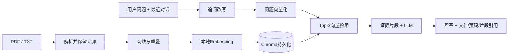

# LlamaIndex RAG 知识库问答 Demo

一个面向 Agent 开发实习岗位的中文命令行项目：**PDF/TXT 解析 → 分块 → 本地语义向量 → Chroma 持久化检索 → DeepSeek 有依据回答**，支持连续追问和文档来源引用。

定位是具备记忆的 RAG 问答助手：使用显式工作流组织检索与生成，不宣称实现了自主规划或 Tool Calling。无需前端、GPU、远程向量库或额外 Embedding API 密钥。

## 核心能力与技术栈

| 能力 | 实现 | 展示价值 |
| --- | --- | --- |
| 文档解析 | pypdf 按页提取 PDF；UTF-8 TXT 读取 | 保留文件名、页码，支持自己的文档 |
| 文档切块 | LlamaIndex `SentenceSplitter`，约450字符/块、60字符重叠 | 中文友好，缓解长文截断和上下文割裂 |
| 向量化 | FastEmbed / ONNX CPU，默认 `BAAI/bge-small-zh-v1.5` | 本地中文语义模型，无需 PyTorch/GPU |
| 向量数据库 | Chroma `PersistentClient` + LlamaIndex `ChromaVectorStore` | 余弦空间、Top-3 检索、跨进程复用索引 |
| RAG 问答 | LlamaIndex `VectorStoreIndex` 检索 + `OpenAILike` 调用 DeepSeek | 将命中片段交给模型，回答限制在证据范围内 |
| 多轮记忆 | 最近6轮成功对话，先用 LLM 将追问改写为独立检索问题 | “那餐补呢”能够关联上一轮出差话题 |
| 来源引用 | 回答内 `[1]` 标记，输出文件名、PDF页码和原文片段 | 检查编号有效且与正文一致，便于人工核对 |
| 工程交付 | 离线测试、依赖锁定、Docker、配置隔离 | 可解释、可复现的个人项目 |

## RAG 原理



Embedding 把语义映射为向量；Chroma 根据向量距离寻找相关片段；LLM 根据片段生成回答。RAG 不会训练或修改大模型。检索分数不是回答正确概率，编号校验也不等同于事实核验，仍需评估片段是否支持结论。

## 项目目录

```text
rag_demo/
├── main.py               # CLI、导入、演示、交互
├── rag_engine.py         # 解析、分块、Embedding适配、Chroma、追问与引用
├── test_rag.py           # 无API/无模型下载的离线测试
├── data/
│   ├── travel_policy.txt # 中文差旅制度，虚构示例
│   ├── onboarding.txt    # 中文入职指南，虚构示例
│   └── security_guide.pdf # 单页英文安全指南，验证PDF页码引用
├── requirements.txt
├── Dockerfile
├── .env.example
├── .gitignore
├── .gitattributes        # PDF按二进制保存，避免Windows换行转换
└── .dockerignore
```

运行后生成 `storage/chroma/` 向量库与 `storage/models/` 模型缓存。导入文件保存在 `data/uploads/`。这些目录与 `.env` 均被 Git 排除。

## 安装与启动

推荐 **Python 3.13（64位）**。首次安装依赖和下载中文模型需要网络，Embedding 在之后的运行中使用本地缓存。模型下载失败时检查 Hugging Face / FastEmbed 模型源连通性。

### Windows PowerShell

```powershell
py -3.13 -m venv .venv
.\.venv\Scripts\python.exe -m pip install -r requirements.txt
Copy-Item .env.example .env
notepad .env
# 填写密钥后运行，无需激活虚拟环境
.\.venv\Scripts\python.exe main.py
```

### Linux / macOS

```bash
python3 -m venv .venv
source .venv/bin/activate
python -m pip install -r requirements.txt
cp .env.example .env
# 编辑 .env，填入密钥
python main.py
```

`.env` 配置：

```dotenv
DEEPSEEK_API_KEY=your_deepseek_api_key
LLM_BASE_URL=https://api.deepseek.com
LLM_MODEL=deepseek-flash
EMBED_MODEL=BAAI/bge-small-zh-v1.5
MIN_SCORE=0.45
```

环境变量优先于 `.env`。生成端默认关闭 DeepSeek thinking。更换其他兼容API时，检查是否支持 `create_llm()` 中的 `thinking` 参数。Embedding 模型必须是 FastEmbed 支持的模型；更换后自动使用独立向量快照。

## 使用自己的文档

把 PDF/TXT 放进 `data/`，或使用命令行导入：

```bash
python main.py --import "你的文档.pdf" --ingest-only
python main.py --import "制度.txt" --chat
python main.py --chat
```

`--import` 可重复指定，相同内容同名文件自动跳过；不同内容同名文件拒绝覆盖，需先重命名。单文件最多20MB。修改源文件后重启程序会使用新的内容快照；未变化的文档集合复用现有向量。

命令速查：

```bash
python main.py                           # 两轮演示，然后聊天
python main.py --demo-only               # 演示后退出
python main.py --chat                    # 直接聊天
python main.py --ingest-only             # 只入库，不需LLM密钥
python main.py --retrieve-only "住宿上限" # 真正语义检索，不需LLM密钥
python -m unittest -v                    # 离线工程测试，不下载模型、不调用API
```

Windows 未激活虚拟环境时将 `python` 换成 `.\.venv\Scripts\python.exe`。交互命令 `/reset` 清空对话记忆，`/exit` 退出。向量库跨进程保留，对话记忆不跨进程保留。

## 演示案例

以下为预期效果，不是伪造的真实API运行记录，实际措辞与命中编号由模型决定。

**第一轮**：公司出差的住宿报销上限是多少？

预期回答：住宿按实际支出报销，每晚最高300元，超出部分自行承担 `[1]`。随后列出 `travel_policy.txt` 与对应原文片段。

**第二轮**：那餐饮补贴呢？

先结合历史改写为“公司出差的餐饮补贴标准是什么？”，再次检索，预期回答每天80元，按出差天数计算 `[1]`。

**PDF测试问题**：What should I do if I suspect a security incident?

预期引用 `security_guide.pdf` 第1页，回答联系IT支持并保留日志。

**无依据问题**：公司宠物医疗补贴是多少？

应说明文档不足以支持回答；模型未提供引用时程序统一返回证据不足，不把无来源结论作为答案。

## Docker

安装并启动 Docker 后，在项目目录执行：

```bash
docker build -t llamaindex-rag-demo .
docker run --rm -it --env-file .env -v rag-storage:/app/storage llamaindex-rag-demo
docker run --rm -v rag-storage:/app/storage llamaindex-rag-demo python main.py --retrieve-only "住宿上限"
docker run --rm llamaindex-rag-demo python -m unittest -v
```

命名卷 `rag-storage` 保存模型缓存和向量库。镜像以非root用户运行，密钥通过运行时环境注入，不打包 `.env`、上传文件或本地数据库。自定义文档可将文档目录挂载到 `/app/data`，该挂载会替换示例文档集合。

## 测试与边界

交付验证：**Python 3.13.2 下14项离线测试通过，`pip check`通过**；PDF样例已渲染检查，FastEmbed支持的模型列表已确认包含默认中文模型。真实Embedding权重下载与语义效果、DeepSeek在线回答、Docker镜像构建尚未实测；当前环境未配置API密钥且没有Docker。首次运行仍需下载模型，完整问答需填写密钥。

`test_rag.py` 使用测试专用哈希向量和脚本LLM，实际执行 LlamaIndex 解析/分块及 Chroma 存储/检索。测试覆盖 PDF页码、TXT读取、持久化复用、文档更新、连续追问、引用一致性、无证据拒答、API失败不污染记忆、六轮记忆上限、导入冲突与空文档。

- 测试向量不代表正式语义模型；离线测试不能证明真实LLM回答正确率。
- 支持可提取文字的PDF；扫描件需先OCR，不处理复杂表格版式。TXT要求UTF-8。
- 为简化维护，文档集合变化会重建全量内容快照；旧快照保留以避免中途失败破坏旧数据。长期使用应增加快照清理与增量更新策略。
- 不包含跨进程聊天记忆、混合检索、重排序、多用户权限或自主工具规划。
- 检索片段和最近对话会发送给生成API；本地向量化不意味着生成过程也离线。
- 单次LLM调用超时45秒、最多重试1次；追问通常需要“改写 + 生成”两次调用。API失败保留此前成功对话。
- 引用检查验证来源编号存在，不保证模型的每句陈述都被原文蕴含。

## 简历描述

> 基于 Python、LlamaIndex 与 Chroma 实现文档知识库问答助手，支持 PDF/TXT 解析、中文分块、本地 ONNX Embedding 与持久化向量检索；通过历史感知的问题改写支持多轮问答，输出可追踪的文件/页码引用，并提供离线集成测试、模型缓存及 Docker 交付配置。

面试可重点解释：chunk size/overlap 的取舍、Embedding与LLM的区别、Chroma持久化方式、追问为何需要改写、引用校验的局限，以及如何扩展BM25混合检索和reranker。

## 官方资料

- [LlamaIndex FastEmbed 集成思路](https://developers.llamaindex.ai/python/framework/integrations/embeddings/fastembed/)
- [LlamaIndex 官方仓库](https://github.com/run-llama/llama_index)
- [Chroma 文档](https://docs.trychroma.com/)
- [FastEmbed 模型与使用](https://github.com/qdrant/fastembed)
- [DeepSeek API](https://api-docs.deepseek.com/)
